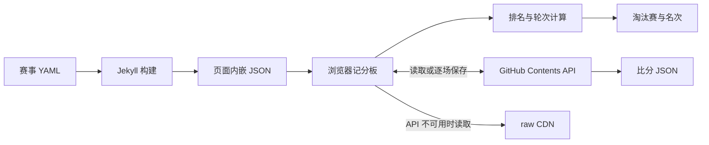

# 实时记分板：设计、使用与维护记录

最后更新：2026-10-27。

本文是 ACTC 实时记分板的统一技术与使用记录。修改记分板实现、赛事配置约定、操作流程或测试方式时，必须在同一次变更中同步更新本文。公开使用指南为 [howto.md](../score_board/howto.md)；旧设计与早期开发记录见 [score_system.md](../score_board/score_system.md)。本文所在的 `ai_tools` 目录不发布到 Jekyll 网站。

## 1. 目标与边界

- 一个赛事页面可包含多个独立比赛项目，每个项目有自己的分组、规则和比分文件。
- 接收主办方已经分好的名单，自动生成小组循环赛、统计排名并推进淘汰赛；也支持无小组、实名签表的直接淘汰赛。
- 观众无需登录；裁判登录后可录入、修改及清除比分。
- 依赖 GitHub Pages 静态网站和 GitHub Contents API，不需要额外业务服务器。
- “实时”指每 60 秒轮询，不是服务器推送；回退到 CDN 时可能延迟数分钟。
- 运行时不自动重新分组；独立抽签工具可在赛前由原始名单生成配置。不安排比赛时间和场地，不支持跨组比较“最佳第三名”等晋级规则。

## 2. 文件与架构

| 文件或目录 | 职责 |
|---|---|
| `_data/events/<id>.yml` | 赛事名称、预先分好的名单和规则 |
| [_data/events/demo.yml](../_data/events/demo.yml) | 现行配置示例 |
| [_includes/event.html](../_includes/event.html) | 输出赛事标题、嵌入 JSON 配置、加载共享 CSS/JS |
| [js/tournament.js](../js/tournament.js) | 比分解析、排名、赛程、签表、GitHub 同步和交互 |
| [css/tournament.css](../css/tournament.css) | 记分板样式，复用网站主题变量 |
| [_config.yml](../_config.yml) | 比分仓库、分支、路径及构建排除项 |
| `events/scores/<id>.json` | 原始比赛结果，由首次保存自动创建 |
| [scripts/test-tournament.js](../scripts/test-tournament.js) | 无第三方依赖的算法回归测试 |
| [skills/generate_draw/generate_draw.js](../skills/generate_draw/generate_draw.js) | 赛前名单解析、种子分组、直接淘汰赛及 YAML 生成 |
| [skills/generate_draw/README.md](../skills/generate_draw/README.md) | 抽签工具输入、命令、默认值与限制 |
| [AGENTS.md](../AGENTS.md)、[workflow.md](../workflow.md) | agent/skill 入口、后续设计开发和更改记录 |
| [score_board/howto.md](../score_board/howto.md) | 对外的组织者、裁判和观众指南 |
| [2026/womens_spring.md](../2026/womens_spring.md) | 正式赛事接入实例 |



静态配置改变后需要重新构建网站；比分读取与保存不依赖网站重建。共享脚本只初始化一次，但可管理页面内多个项目实例。项目标题由 Liquid 直接输出，锚点为 `event-<id>`。

## 3. 新建和接入项目

### 3.1 配置示例

新建 `_data/events/<id>.yml`。ID 使用小写英文字母、数字和连字符，先确认没有同名配置或已使用的比分文件。

```yaml
name: A级别男子单打
groups:
  A: [张伟, 王磊, 李强, 刘洋]
  B: [陈杰, 杨帆, 赵鹏, 黄涛]
rules:
  advance: 2
  points: { win: 1, loss: 0, wo_loss: 0 }
  tiebreakers: [points, h2h, set_diff, game_diff]
  third_place: true
  show_set_column: true
  score_hint: "如 6-4 或 6-4 3-6 [10-8]"
```

| 字段 | 含义与默认行为 |
|---|---|
| `name` | 项目标题，可选 |
| `groups` | 组名到选手名单的映射；每组人数可不同 |
| `seeds` | 可选的姓名到原种子编号映射，供抽签核对，运行时不据此重排晋级 |
| `rules.advance` | 每组前 N 名出线；有小组时为 0 仅循环赛；无小组且有 draw 时直接淘汰赛 |
| `rules.points` | 默认胜 1 分、负 0 分、弃权负 0 分 |
| `rules.tiebreakers` | 默认 `[points, h2h, set_diff, game_diff]` |
| `rules.draw` | 可选，手动指定淘汰赛首轮对阵，优先于自动签表 |
| `rules.third_place` | 为 `true` 且有半决赛时加打三四名决赛 |
| `rules.show_set_column` | 为 `false` 时隐藏“盘”列；默认显示，不影响统计和排名 |
| `rules.score_hint` | 裁判比分输入框的提示文字 |
| `rules.show_order` | 历史字段，已忽略；Table / Match 始终提供 |

双打组合仍是一个完整字符串；使用 `张三 & 李四`，界面会将两位球员分行显示。名单顺序决定表格顺序、组内比赛顺序及排名完全相同时的最终顺序。不要擅自推定正式赛事的出线、积分或排名规则。

### 3.2 页面接入

在赛事 Markdown 页面中加入：

```liquid

```

`id` 必须与 YAML 文件名一致，不需要再在 YAML 中添加 `id` 字段。同页可多次 include 不同项目。页面 front matter 可设置 `wide: true`，为交叉表提供更多空间；目录链接可用 `#event-2026-ms-a`。

开赛后不要改项目 ID、组名和选手姓名，否则原比分可能无法匹配。调整名单顺序也会改变轮次及未能区分的同分排序；调整组顺序或签表会改变淘汰赛位置。需要调整时，应先评估现有成绩的影响，不覆盖真实比分文件。

### 3.3 从名单抽签生成 YAML

使用 `generate-draw` skill 或独立 Node.js 工具：

```powershell
node skills/generate_draw/generate_draw.js --players players.txt --groups 4 --advance 2 --name "Tennis event" --output _data/events/new-event.yml
```

支持 UTF-8 文件、`--text` 或 `--players -` 标准输入；名单每位/对一行，或混用中英文逗号、分号。双打整对视为一个参赛者。末尾 `[编号]` 表示正整数种子，拒绝重名与重复种子（`[02]` 等同 `[2]`），允许缺号。输出姓名保留 `Harper Liu [1]` 这样的标记，小组名单、实名签表和顶层 `seeds` 映射统一使用该完整姓名，编号规范为十进制整数。缺号种子按相对顺序紧凑安排，不制造空参赛位。标记属于比分匹配姓名的一部分，不对已开赛的旧配置自动补标记，以免原成绩失配。

N > 0 时，N 为小组数，必须明确 J（`--advance`），J 不能超过最小组人数，J = 0 只打循环赛。先随机确定多出名额归属，保证组人数差不超过 1；首层种子按顺位分散，按容量和种子数量预分配每组种子名额，优先让高种子组少接收额外种子（“种子轮空”，并非比赛 BYE）。首层之后逐层打乱目标组名额，将该层种子随机分配，不固定正向、反向或蛇形；随后随机填充非种子。8 位种子分 5 组时，1/2 号种子各自所在组不含其他种子，后三位种子随机进入 C/D/E。容量限制优先满足。组内种子按顺位列在名单前面，两位种子时末轮相遇；种子多于小组数量时不承诺所有种子在小组阶段回避。

J = 2 时，工具同时生成固定 `rules.draw`，保存轮空和同组半区回避：先给高种子组第一名轮空；若所有组第一均已轮空，余下轮空在满足半区约束的组第二之间随机分配。5 组 10 人出线时，五个组第一和等概率随机选择的一个组第二获得六个轮空；6 组 12 人出线时，前四种子组第一名 A1～D1 获得四个轮空。5 组情况下可在 5～8 号签位区间内调整 E1，保证任一组第二均可被随机选中、前四种子位保护且同组决赛前回避。签表保存后不随刷新重抽；其他 J 沿用记分板默认自动签表。已生成的旧文件不会被自动改写。

N = 0 时至少两名/对参赛者，忽略 J，输出 `groups: {}`、`rules.advance: 0`、实名 `rules.draw`。采用标准种子位置，签表补至 2 的幂，BYE 优先给编号较小的种子，其余轮空随机分配给非种子，不生成 BYE 对 BYE。

其他字段默认：`name: Tennis event`（可指定）、胜 1 分/负 0 分/弃权负 0 分、`[points, h2h, set_diff, game_diff]`、三四名赛及盘列开启、比分提示 `6-4 / 6-4 3-6 [10-8]`。正式赛事应确认默认规则。输出使用安全引号和流式数组/映射的 YAML，不需额外运行依赖；已有输出拒绝覆盖，正式配置目录另检查同 ID 比分文件。不会生成成绩、发布页面或连接 GitHub。

## 4. 分组、种子与比赛顺序

### 4.1 种子约定

抽签工具读取名单末尾的种子编号，并可在 YAML 的 `seeds` 中保留；记分板运行时不根据该元数据重新抽签或重排选手。现有约定是：

1. 配置中的组顺序用于安排各组第一名的淘汰赛种子位，其后再安排各组第二名、第三名等。
2. 标准种子签位使 1/2 分处上下半区，只可能决赛相遇；3/4 与前两位最早半决赛相遇；5～8 与前四位最早四分之一决赛相遇。
3. 这是签位保护，不是按实际选手种子身份重排晋级名次。种子未获预期小组名次时，系统仍按真实成绩晋级。
4. 小组有两位种子时，应将其列在组内名单第 1、2 位，保证他们最后一轮相遇。

### 4.2 小组轮次算法

`roundRobin()` 使用圆周法（Circle / Berger）：

- 偶数 N 人共 N−1 轮；奇数 N 人补一个轮空位，共 N 轮。
- 每轮每人最多打一场，每一对选手恰好相遇一次。
- 奇数组每人恰好轮空一次。
- 名单第 1、2 位最后一轮相遇。

4 人示例：第 1 轮 `1v4、2v3`；第 2 轮 `1v3、2v4`；第 3 轮 `1v2、3v4`。

比赛顺序由名单计算，不保存到比分文件。比赛键与名单次序无关，因此仅改变同组名单顺序不会改变已有对阵记录的键，但不建议比赛中调整。

## 5. 界面和交互

### 5.1 小组 Table / Match

- 小组名在左上角，右上角为 Table / Match 分段切换；默认 Table。
- Table 显示交叉比分、胜负、可选盘数、局数及排名；交叉比分按该行选手视角显示。
- Match 按“第 1 轮、第 2 轮……”显示对阵、选手序号、轮空和已完成比分；胜者突出显示。
- 每个小组独立选择视图。选择保存在项目实例的 `groupViews` 中，刷新比分、保存成绩或重新渲染后保留；整页重载后回到默认 Table，不写入 localStorage。
- 裁判可点击交叉表格子或 Match 中的比赛打开同一个录入弹窗；观众只读。
- 小组进度显示已完成场数 / 总场数；小组完成后，出线行使用绿色标识。
- 小组卡片响应式排列；交叉表及淘汰赛签表可在容器内横向滚动。

### 5.2 顶部状态与淘汰赛

状态依次为“尚未开赛”“小组赛进行中 x/y”“淘汰赛进行中”“比赛结束”。顶部提供比分刷新、裁判登录或退出入口及可用的最后更新时间。

淘汰赛按轮次展示，未决选手显示“A组第1名”或“第N场胜者”等占位。双方确定后裁判可录入；轮空自动晋级；决赛结束显示冠军和亚军，启用三四名赛时也显示季军。

## 6. 比分解析和排名

### 6.1 比分格式

支持 `6-4`、`7-6(5)`、`6-4 3-6 [10-8]`；可用空格、逗号、分号分隔，盘内可用 `-` 或 `:`。完整字符串按记录的 `p[0]` 视角解释，反向展示时翻转双方分数。

- 正常完赛：由胜盘数自动判定胜者，胜盘相同不能保存为正常结果。
- `[10-8]` 为抢十，统计局数时只给胜者计 1 局。
- `W/O`：手动选择胜者，忽略比分；胜者得胜积分，负者得 `wo_loss`，不计盘局。
- `RET`：手动选择胜者，已输入比分参与盘局统计，比分可留空。
- 解析器检查格式及单盘非平分，不完整校验所有网球赛制的合法终局分数；正式赛制仍由组织者和裁判把关。

### 6.2 统计与同分

`computeGroup()` 遍历所有两两对阵，统计出场、胜负、积分、胜负盘和胜负局。只有含有效胜者且双方匹配的结果才算完成。

| 排名指标 | 含义 |
|---|---|
| `points` / `wins` | 积分 / 胜场 |
| `h2h` | 当前同分子集内部的相互战绩胜场 |
| `set_diff` / `game_diff` | 净胜盘 / 净胜局 |
| `sets_won` / `games_won` | 胜盘 / 胜局 |
| `games_lost` | 负局越少越优先 |
| `set_ratio` / `game_ratio` | 胜盘占已打总盘的比例 / 胜局占已打总局的比例 |

`rankPlayers()` 按配置逐项比较；一项将同分选手拆成更小子集后，每个仍同分的子集从第一项重新比较。所有指标都相同时按名单顺序排序，不支持手动覆盖抽签排序。

## 7. 出线和淘汰赛

某组全部比赛完成后，该组前 `advance` 名立即填入签表，不必等待其他小组。未完赛组保持名次占位，不使用临时排名提前确定选手。

### 7.1 自动签表

`autoDraw()` 按各组第一名、各组第二名等生成名单，签表大小补到不小于人数的 2 的幂。`seedOrder()` 生成标准种子位置，例如 8 签为 `1-8、4-5、2-7、3-6`，不足的位置为 BYE。

- 每组**恰好 2 人出线**时，固定各组第一名位置，把同组第二名放在相反半区；必要时交换第二名或轮空位置，同组只可能在决赛相遇。
- 其他出线人数采用同名次、非第一名之间的交换优化，尽量推迟同组相遇；不承诺决赛前回避。
- 同组回避代价为 `2^(总轮数 - 相遇轮次)`，只有降低总代价的交换才接受。

### 7.2 手动签表

```yaml
rules:
  advance: 2
  draw:
    - [A1, B2]
    - [B1, A2]
```

`A1` 表示 A 组第一名，也可写 `BYE` 或直接写选手全名。由上至下为首轮各场，相邻两场胜者下一轮相遇。手动签表优先，系统不会自动重排种子或修正同组回避；组织者须自行检查。首轮场数不是 2 的幂时补 `BYE vs BYE`。

`computeKO()` 逐轮推进胜者，必要时将半决赛负者送入三四名赛。若修改小组成绩导致选手变化，原淘汰赛结果只有双方仍匹配时才有效，不会错误套用。

### 7.3 直接淘汰赛

当 `groups` 为空且 `rules.draw` 是非空数组时，`compute()` 即使在 `advance: 0` 下也计算淘汰赛。此时 `render()` 不显示空的小组标题、提示或卡片，首轮实名选手可直接录入。BYE 自动推进；现有 KO 比分键、裁判录入及晋级逻辑不变。有小组时，`advance: 0` 仍保持仅循环赛行为。

## 8. 比分存储与同步

[_config.yml](../_config.yml) 当前设置：

```yaml
tournament_scores:
  repo: tennis4acta/tennis4acta.github.io
  branch: master
  path: events/scores
```

首次录入时创建 `events/scores/<id>.json`，不预造真实比赛结果。数据结构示例：

```json
{
  "matches": {
    "RR|A|Alice|Bob": {
      "p": ["Alice", "Bob"], "s": "6-4", "w": "Alice",
      "t": "2026-10-27T09:00:00.000Z", "by": "referee"
    }
  },
  "updated": "2026-10-27T09:00:00.000Z"
}
```

`p` 是双方姓名，`s` 是第一位选手视角的比分，`w` 是胜者；可选 `n` 为 `W/O` 或 `RET`，`t` 和 `by` 用于审计。

- 小组键：`RR|<组名>|<姓名1>|<姓名2>`，姓名按 JavaScript 默认字典序排序，不按显示顺序或中文拼音排序。
- 淘汰赛键：`KO|<轮次>|<场次>`，三四名赛为 `KO|3rd`。
- `result()` 校验双方和胜者，自动处理相反的记录方向；不匹配的记录忽略。

### 8.1 读取

裁判使用带令牌的 Contents API；观众先用匿名 API，403/429 限流后转 raw CDN，后续优先走 CDN。404 视为空赛事。每 60 秒尝试刷新，页面在后台或录入弹窗打开时暂停常规刷新，回到前台再次刷新；手动刷新可立即请求。

### 8.2 保存与并发

每次保存先获取最新文件和 SHA，只合并当前一场，再以 SHA 写回。遇到 409/422 冲突最多重试两次；不同场次的并发操作尽量保留彼此结果。同一场并发编辑没有人工冲突合并界面，仍需裁判协调。

写入按键排序，中文通过 UTF-8 / Base64 编码。每次保存生成 GitHub commit，可在仓库提交历史中追踪。比分提交可能触发 Pages 构建，但比分读取不等待构建。若改用独立比分分支，先创建该分支并设置 `tournament_scores.branch`。

## 9. 组织者、裁判和观众操作

### 9.1 组织者

1. 确认分组名单、种子安排、积分、同分规则、出线人数和三四名赛要求。
2. 创建唯一 ID 的 YAML，按需配置手动签表，并在赛事页面 include。
3. 检查名字、组顺序、人数、轮次、出线位和轮空，确认没有覆盖旧项目或比分。
4. 按仓库正常流程发布，正式比赛前使用隔离测试项目演练完整流程。
5. 由管理员自行创建 Fine-grained PAT，仅授权本仓库的 Contents: Read and write，设置覆盖比赛日的短有效期，私下交给可信裁判。
6. 比赛结束后撤销令牌，按需要归档成绩。

### 9.2 裁判

1. 打开页面，点击“裁判登录”，在页面中自行输入管理员提供的令牌。
2. 在 Table 点对应格子，或切到 Match 按轮次点击比赛。
3. 比分按弹窗第一位选手的视角输入；正常完赛自动判胜，W/O 或 RET 需手动选胜者。
4. 保存后检查比分、排名和晋级结果；录错可再次点击修改，已有结果可“清除比分”。
5. 淘汰赛双方确定后，用“录入 / 修改”继续记录。
6. 结束或交接设备时点击“退出计分”。同设备登录对同页各项目生效。

### 9.3 观众

无需登录，直接查看 Table 积分和 Match 轮次。页面定时刷新，也可手动刷新；共用现场 Wi-Fi 时可能因匿名限流产生数分钟延迟。

## 10. 安全与排错

- 令牌仅保存在裁判浏览器 localStorage，退出时清除；不得写入源码、文档、测试、日志或聊天。不要让 AI 获取令牌。
- 令牌权限作用于整个仓库，并非只限比分文件；仅向可信裁判发放，赛后撤销。共享设备务必退出。
- 用户文本通过 DOM / textContent 渲染，不使用 innerHTML；Liquid JSON 中的 `<` 转义为 `\u003c`，防止中断 script 标签。
- 校验项目 ID 和仓库格式，对路径段编码；写入使用 SHA 乐观锁。

| 问题 | 检查方向 |
|---|---|
| 看不到项目 | YAML 文件名与 include ID、配置有效性、JS 加载 |
| 新赛事没有比分文件 | 未首次保存时正常，不手动填造结果 |
| 某条成绩未显示 | 键中组名和姓名排序、`p` 双方、`w` 胜者是否匹配 |
| 登录无效或无法保存 | 令牌有效期、仓库授权、Contents 写权限、网络与冲突提示 |
| 观众比分落后 | 页面刷新、后台暂停、匿名 API 限流或 CDN 缓存 |
| 淘汰赛仍显示占位 | 该组是否全部完赛、draw 是否引用正确组名和名次 |
| 修改小组结果后 KO 成绩消失 | 双方已变化，旧结果失效属于保护行为，需核实后重录 |

## 11. 验证方式与记录

常用命令：

```powershell
node --check js/tournament.js
node scripts/test-tournament.js
node --test skills/generate_draw/generate_draw.test.js
git diff --check
```

算法回归脚本使用 Node.js 标准库，在 VM 中加载生产算法，不需要额外依赖。当前覆盖：2～32 人循环赛轮数、唯一对阵、每轮出场、奇数组轮空、前两位末轮相遇；1～64 组两人出线的半区回避与第一名签位稳定；8～64 签前八种子隔离；手动 draw 优先；原有比分方向和排名读取。

抽签工具测试覆盖名单、种子校验、平衡分组、随机多出名额、稀疏种子、种子优先 BYE、CLI 输入/输出保护以及生产记分板计算集成。可选使用已有 `js-yaml` 独立往返解析生成文件；缺少时该项跳过，不自动安装依赖。2026-10-27 本次实际执行 8 组通过且无跳过；直接淘汰赛新增记分板回归也通过。

同次浏览器隔离测试确认直接淘汰赛不显示空小组区，三轮签表、三个 BYE 及种子自动晋级正常；未连接真实比分。文档本地链接、skill/指令 YAML 和发布排除项检查通过，开发过程见 `workflow.md`。

2026-10-27 实际验证：上述算法回归、编辑器诊断和差异检查通过。使用 git 忽略的 `_site/preview/tournament.html`，模拟 fetch 而不连接真实比分；浏览器检查 Table / Match、5 人轮次、比分显示、组间独立状态、刷新后保持选择、桌面及 375px 窄屏布局，均通过。预览不随仓库发布；需要时重新建立隔离预览，不将测试结果写入正式比分。

早期设计文档记载了模拟 API 下的录入、W/O、RET、抢十、排名及淘汰赛推进测试，属于历史记录，不代表本次重新执行。

**尚未验证的外部流程**：真实 GitHub API 写入、令牌权限、真实并发冲突、CDN 限流回退，以及 Jekyll 实际构建。当前本机没有 Jekyll；正式比赛前仍需由管理员在测试项目中做端到端演练。

## 12. 变更记录与同步要求

| 阶段 | 记录 |
|---|---|
| 初始系统 | Jekyll 配置、交叉表、排名、淘汰赛、GitHub 逐场保存、多项目与公开使用指南 |
| 后续完善 | 新增排名指标、循环赛轮次、可选顺序折叠区、双打姓名分行、精简表格和盘列开关 |
| 2026-10-27：比赛顺序 | Table / Match 取代折叠区；忽略旧 show_order；视图选择在比分刷新后保留；两人出线明确分离半区；增加回归脚本 |
| 2026-10-27：统一记录 | 本文成为统一设计与使用记录，新增自动匹配的维护指令，赛事 skill 引用本文，内部目录从网站发布中排除 |
| 2026-10-27：抽签工具 | 新增 `skills/generate_draw` CLI 与 `generate-draw` skill；记录稀疏种子、平衡分组、种子优先 BYE、YAML 默认值；记分板支持无小组直接淘汰赛；新增 `AGENTS.md` 与 `workflow.md` 持续维护入口 |
| 2026-10-27：保留种子标记 | 抽签输出姓名保留 `[编号]`，小组、实名签表及 seeds 键一致；现有测试分组仅补标记，不重新抽签；新增标记保留测试，抽签回归 9 组通过 |
| 2026-10-27：高顺位保护 | 额外种子始终优先进入低种子组；两人出线时生成固定签表，先保护高种子组第一，按 10/12 人规则分配轮空并保持同组半区分离；新增第三层种子与 1～64 组签表测试，抽签回归 14 组通过 |
| 2026-10-27：后续种子层随机化 | 首层按顺位，其后每层随机分配到预定种子名额；保留高顺位种子的种子轮空与容量约束，不再固定反向或蛇形；15 组抽签测试通过，既有配置不重抽 |

后续每次修改时：

1. 先阅读本文及受影响代码，保留已有赛事成绩和用户改动。
2. 同步更新受影响的设计、字段默认值、操作流程、兼容性或限制；在本节记录行为变化。
3. 用户可见的流程变化同时更新公开指南；配置约定变化同时更新 demo 和赛事 skill。
4. 执行与改动对应的检查，记录实际验证范围及未验证项，不将历史结果写成本次通过。
5. 不要求只改无关网站内容时更新本文；只增加一场赛事时，仅在出现新的规则或使用约定时补充记录，避免重复维护全部名单与比分。