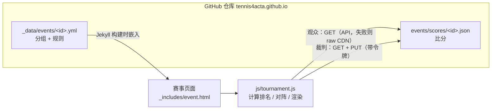
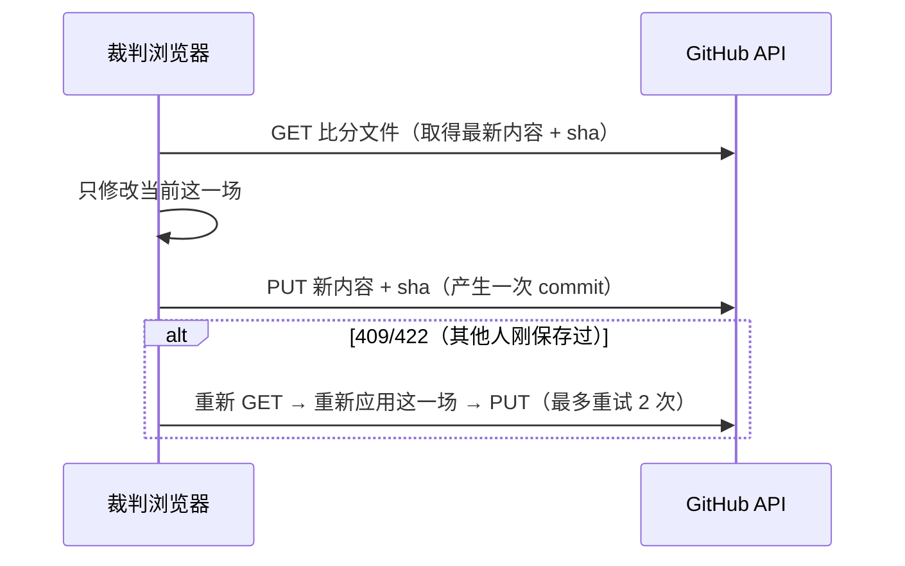

# 赛事计分系统（Score System）设计文档

> 本文档记录 ACTC 网站赛事计分系统的需求、设计架构、数据格式、核心算法、部署与使用方法，以及开发过程。
> 本文件为内部文档，已在 `_config.yml` 的 `exclude` 中排除，不会发布到网站。

---

## 1. 背景与需求

一次赛事（tournament）包含多个项目（event），如男子单打 A 级别、女子双打等。每个项目需要一个网页：

1. 主办方只需提供**已分好组的选手名单**；
2. 页面根据名单**自动生成小组循环赛表**；
3. 提供界面让主办方 / 裁判在比赛中**录入、修改比分**；
4. 按设定规则，小组赛结束后**自动进入淘汰赛**，淘汰赛同样可录入比分；
5. 尽量**只依赖 GitHub Pages** 部署，不引入额外服务器或付费服务。

---

## 2. 方案选择

GitHub Pages 只能托管静态文件，没有后端，因此"比分保存在哪里"是核心问题。考虑过的方案：

| 方案 | 优点 | 缺点 | 结论 |
|---|---|---|---|
| 浏览器 localStorage + 导入导出 | 零依赖 | 只能单设备，观众看不到 | 否 |
| Firebase / Supabase 等第三方后端 | 实时性好 | 超出"只用 GitHub"的要求，需要另外维护账号 | 否 |
| **GitHub Contents API 直接提交 JSON 到仓库** | 只用 GitHub；每次录入都是一次 git commit，可追溯、可回滚 | 录入者需要 GitHub 令牌；观众端有少量延迟 | **采用** |

最终架构：**配置由 Jekyll 在构建时嵌入页面，比分由浏览器端 JS 通过 GitHub API 实时读写，所有计算（排名、晋级、对阵）都在浏览器中完成。**

---

## 3. 总体架构



数据流说明：

- **配置（静态）**：`_data/events/<id>.yml` 在 Jekyll 构建时通过 `jsonify` 嵌入页面的 `<script type="application/json">` 中。修改配置需要重新构建网站（push 后 GitHub Pages 自动构建）。
- **比分（动态）**：`events/scores/<id>.json` 由 JS 在运行时直接从 GitHub 读取，不依赖网站重新构建。
- **计算（客户端）**：小组积分、排名、出线名单、淘汰赛对阵、冠亚季军全部根据"配置 + 比分"在浏览器端实时计算，比分文件中只保存每场比赛的原始结果。

---

## 4. 文件清单

| 文件 | 作用 |
|---|---|
| `_data/events/<id>.yml` | 每个项目的配置：名称、分组名单、规则 |
| `_data/events/demo.yml` | 配置示例（含全部可选项的注释） |
| `_includes/event.html` | 页面组件：输出标题、嵌入配置、加载 CSS/JS |
| `js/tournament.js` | 核心逻辑：比分解析、排名、对阵生成、GitHub 读写、界面渲染 |
| `css/tournament.css` | 样式（沿用 `css/actc.css` 的 CSS 变量，支持深色模式） |
| `events/demo.md` | 演示页面，正式使用前可删除或替换 |
| `events/scores/<id>.json` | 比分数据，首次录入时由系统自动创建 |
| `_config.yml` → `tournament_scores` | 比分存储位置（仓库、分支、目录） |

`_config.yml` 中的设置：

```yaml
tournament_scores:
  repo: tennis4acta/tennis4acta.github.io
  branch: master
  path: events/scores
```

---

## 5. 数据格式

### 5.1 项目配置 `_data/events/<id>.yml`

```yaml
name: A级别男子单打          # 页面标题
groups:                      # 组名 → 选手（双打写 "张三 / 李四"）
  A: [张伟, 王磊, 李强, 刘洋]
  B: [陈杰, 杨帆, 赵鹏, 黄涛]
rules:
  advance: 2                 # 每组前 N 名出线；0 = 只打循环赛
  points: { win: 1, loss: 0, wo_loss: 0 }   # 胜 / 负 / 弃权负 积分
  tiebreakers: [points, h2h, set_diff, game_diff]
  draw:                      # 可选：手动指定淘汰赛首轮对阵
    - [A1, B2]
    - [B1, A2]
  third_place: true          # 是否打三四名决赛
  score_hint: "如 6-4 或 6-4 3-6 [10-8]"     # 录入框提示文字
```

`draw` 中可用的写法：`A1`（A 组第 1 名）、`BYE`（轮空）、或直接写选手姓名。

### 5.2 比分文件 `events/scores/<id>.json`

```json
{
  "matches": {
    "RR|A|刘洋|张伟": { "p": ["张伟", "刘洋"], "s": "6-3", "w": "张伟", "t": "2026-11-15T09:12:00.000Z", "by": "referee1" },
    "RR|C|周斌|孙浩": { "p": ["周斌", "孙浩"], "s": "", "w": "孙浩", "n": "W/O", "t": "..." },
    "KO|1|1":        { "p": ["张伟", "吴昊"], "s": "6-2 6-7(3) [10-5]", "w": "张伟", "t": "..." },
    "KO|3rd":        { "p": ["杨帆", "赵鹏"], "s": "6-0", "w": "杨帆", "t": "..." }
  },
  "updated": "2026-11-15T09:30:00.000Z"
}
```

| 字段 | 含义 |
|---|---|
| `p` | 双方选手，`s` 中的比分以 `p[0]` 的视角书写 |
| `s` | 比分字符串 |
| `w` | 胜者姓名 |
| `n` | 可选：`W/O`（弃权）或 `RET`（中途退赛） |
| `t` / `by` | 录入时间 / 录入者 GitHub 用户名（审计用） |

**比赛键（key）规则：**

- 小组赛：`RR|<组名>|<姓名1>|<姓名2>`，两个姓名按字典序排序，与名单顺序无关。
- 淘汰赛：`KO|<轮次>|<场次>`，三四名决赛为 `KO|3rd`。

**一致性校验：** 读取时会检查记录中的 `p` 是否与当前对阵双方一致，不一致的记录会被忽略。因此：

- 小组赛结果改变导致淘汰赛对阵变化时，旧的淘汰赛比分自动失效，不会被错误地套用到新的对阵上；
- 选手改名或替换后，旧比分不再计入（所以**开赛后不要修改姓名**）。

---

## 6. 核心算法（`js/tournament.js`）

### 6.1 比分解析

- 支持格式：`6-4`、`7-6(5)`、`6-4 3-6 [10-8]`，分隔符可为空格、逗号或分号，`-` 和 `:` 均可。
- 方括号 `[10-8]` 表示抢十（match tiebreak），统计局数时计为 1 局。
- 正常完赛时由比分自动判定胜者（胜盘多者胜）；`W/O` / `RET` 时由录入者手动选择胜者。
- 交叉表中的比分会自动翻转为该行选手的视角（`6-4` ↔ `4-6`）。

### 6.2 小组统计

对每组所有两两对阵统计：胜、负、积分、胜盘 / 负盘、胜局 / 负局。

- 弃权（W/O）：胜者得 `win` 分，败者得 `wo_loss` 分，不计盘局。
- 中途退赛（RET）：按已录入的盘局计入。

### 6.3 排名与同分处理（ITF 方式）

按 `tiebreakers` 列表依次比较，可用指标：

| 指标 | 含义 |
|---|---|
| `points` | 积分 |
| `wins` | 胜场 |
| `h2h` | 相互战绩（仅在当前同分选手之间计算） |
| `set_diff` / `game_diff` | 净胜盘 / 净胜局 |
| `set_ratio` / `game_ratio` | 胜盘率 / 胜局率 |
| `sets_won` / `games_won` | 胜盘数 / 胜局数 |
| `games_lost` | 负局数（少者优先，内部取负值比较） |

递归规则：某项指标把同分选手分成若干层后，每个仍同分的**更小**子集从第一项指标**重新开始**比较（因此 `h2h` 会在新的子集内重新计算）。所有指标都无法区分时，按配置名单中的顺序排列。子集严格变小，递归必然终止。

测试验证：三人循环互胜（各 1 胜），`h2h` 无法区分 → 净胜盘相同 → 按净胜局排出名次，结果正确。

### 6.4 出线

- 某组**全部比赛完成**后，该组前 `advance` 名立即填入淘汰赛对应位置（不必等所有小组结束）。
- 未完成的组在对阵表中显示占位文字，如"A组第1名"。

### 6.5 淘汰赛自动对阵（未配置 `draw` 时）

1. 种子顺序：各组第 1 名（A1, B1, C1…），然后各组第 2 名（A2, B2…），依此类推；
2. 签表规模取不小于出线人数的 2 的幂，多出的位置为轮空（BYE），轮空自动分配给高种子；
3. 按标准种子位置排布（8 签：1-8, 4-5, 2-7, 3-6）；
4. **同组回避优化**：在名次相同的非第一名选手之间做交换（爬山法），代价函数为同组选手可能相遇的轮次越早代价越高（`2^(总轮数 - 相遇轮次)`），使同组选手尽量晚相遇。

示例（4 组各出 2 人）生成结果：

```
上半区：A1 vs C2，D1 vs B2
下半区：B1 vs D2，C1 vs A2
```

同组的第 1、2 名分处不同半区，只可能在决赛相遇。

手动配置的 `draw` 场数不是 2 的幂时，会自动补 `BYE vs BYE`。

### 6.6 淘汰赛推进

- 每场的胜者 / 负者作为下一轮或三四名决赛的选手；
- 一方轮空时另一方直接晋级（对手尚未确定时，显示其占位文字并继续向后传递）；
- 未决出时显示"第N场胜者 / 负者"；
- 决赛决出后显示冠军、亚军（以及季军）。

### 6.7 赛事状态

尚未开赛 → 小组赛进行中 x/y → 淘汰赛进行中 → 比赛结束。

---

## 7. 存储与同步（GitHub API）

### 7.1 读取

| 角色 | 读取方式 | 实时性 |
|---|---|---|
| 裁判（已登录） | `GET /repos/{repo}/contents/{path}`（带令牌，5000 次/小时） | 实时 |
| 观众 | 同上但不带令牌（每个 IP 60 次/小时） | 实时 |
| 观众（被限流后） | 回退到 `raw.githubusercontent.com` | CDN 缓存，最多约 5 分钟延迟 |

- 页面每 60 秒自动刷新一次；页面切到后台时暂停，切回时立即刷新；编辑窗口打开时不刷新。
- 比分文件不存在（404）时视为空，不报错。

### 7.2 写入（逐场保存 + 冲突重试）



- 每次只合并一场比赛的修改，多名裁判同时录入不同场次不会互相覆盖。
- 提交信息示例：`score(demo): D组 郭峰 vs 何勇 4-6`，可在 GitHub 提交历史中追溯每一次修改，必要时 revert。
- JSON 中的 `matches` 按键名排序，便于查看 diff。
- 中文内容使用 UTF-8 → Base64 编码（`TextEncoder` / `TextDecoder`）。

---

## 8. 安全设计

| 风险 | 措施 |
|---|---|
| 令牌泄露 | 使用**细粒度令牌**（Fine-grained PAT），只授权本仓库、只给 `Contents: Read and write`、设置短有效期；令牌只保存在裁判设备的 localStorage 中，不写入仓库；提供"退出计分"按钮清除；赛后撤销 |
| XSS（选手姓名等用户数据） | 界面全部用 `createElement` + `textContent` 构建，不使用 `innerHTML` |
| 配置注入破坏 `<script>` 标签 | Jekyll 输出配置时 `jsonify` 后把 `<` 替换为 `\u003c` |
| 恶意 id / 仓库参数 | JS 对 `id`、`repo` 做正则白名单校验，路径段统一 `encodeURIComponent` |
| 并发覆盖 | 基于 sha 的乐观锁 + 冲突重试（见 7.2） |

注意：拥有令牌的人可以修改仓库中的任意文件内容（权限范围是整个仓库），因此只应分发给可信的裁判。

---

## 9. 使用指南

### 9.1 新建项目

1. 复制 `_data/events/demo.yml` 为 `_data/events/<id>.yml`（id 用英文、数字、`-`），填写名称、分组和规则；
2. 在任意页面中加入（可以一页放多个项目）：

   ```liquid
   
   
   ```

3. 页面头部建议加 `wide: true`；
4. 标题锚点为 `#event-<id>`，可用于目录链接，如 `[A级别男子单打](#event-2026-ms-a)`。

### 9.2 创建裁判令牌

GitHub → Settings → Developer settings → Personal access tokens → **Fine-grained tokens** → Generate new token：

- Resource owner：`tennis4acta`
- Repository access：Only select repositories → `tennis4acta.github.io`
- Permissions → Repository permissions → **Contents: Read and write**
- Expiration：覆盖比赛日即可

### 9.3 比赛当天

1. 裁判打开赛事页面 → 点"裁判登录" → 粘贴令牌；
2. 小组赛：点击交叉表中的格子录入比分（以该行选手的视角）；
3. 某组完赛后，出线选手自动进入淘汰赛对阵表；
4. 淘汰赛：点击对阵框上的"录入 / 修改"；
5. 录错可修改或"清除比分"，也可在 GitHub 提交历史中 revert；
6. 赛后点"退出计分"，并在 GitHub 上撤销令牌。

### 9.4 注意事项

- 开赛后**不要修改项目 id 和选手姓名**；
- 每次保存都会触发一次 GitHub Pages 构建（软限制约 10 次/小时，超出会排队，但不影响比分读取，因为比分不依赖网站构建）。如需避免，可新建 `scores` 分支并把 `_config.yml` 中的 `tournament_scores.branch` 改为 `scores`（分支需事先存在）；
- 场地多人共用同一 Wi-Fi 时，观众端可能触发 API 限流，自动回退到 CDN，比分会有数分钟延迟；
- 正式使用前删除或替换演示文件 `events/demo.md`、`_data/events/demo.yml`。

---

## 10. 测试记录

本机未安装 Jekyll，因此在临时 HTML 测试页（放在 git 忽略的 `_site/` 中，测试后已删除）中手工嵌入配置，并模拟 `fetch` 拦截 GitHub API 进行端到端测试：

| 测试项 | 结果 |
|---|---|
| `node --check js/tournament.js` 语法检查 | 通过 |
| 4 组 × 4 人交叉表、积分、盘局统计 | 正确 |
| 三人循环互胜的同分排名（h2h → 净胜盘 → 净胜局） | 正确 |
| W/O 计分及显示 | 正确 |
| 抢十 `[10-8]` 计 1 局 | 正确 |
| 未完赛小组显示占位、名次灰显 | 正确 |
| 自动对阵同组回避（A1/A2 分处上下半区） | 正确 |
| 裁判登录、录入、格式错误提示、自动判定胜者 | 正确 |
| 最后一场小组赛录入后状态切换为"淘汰赛进行中"，出线选手自动填入 | 正确 |
| 淘汰赛 W/O、RET、三盘抢十、半决赛、决赛、三四名决赛 | 正确，显示冠军 / 亚军 / 季军 |
| 每次保存生成的 commit 信息 | 正确 |

**尚未测试**：真实 GitHub API 的读写（令牌权限、409 冲突重试、raw CDN 回退）以及 Jekyll 实际构建。建议正式比赛前用一个测试项目做一次完整的录入演练。

---

## 11. 已知限制与后续可选改进

- 不支持"成绩最好的小组第三名"等跨组比较的出线方式（可通过手动 `draw` 写选手姓名变通）；
- 同分全部指标都无法区分时按名单顺序排名，暂不支持抽签结果的手动覆盖；
- 不支持赛程时间 / 场地安排；
- 观众端非实时推送，依赖 60 秒轮询；
- 未来可考虑：比分存独立分支、赛程与场地分配、按选手筛选、导出成绩到历史赛事页面。

---

## 12. 开发过程记录

| 步骤 | 内容 |
|---|---|
| 1. 需求分析 | 多项目赛事；名单已分组；自动生成循环赛表；在线录入比分；小组赛后自动进入淘汰赛；仅用 GitHub Pages |
| 2. 现状调研 | 网站为 Jekyll（`permalink: pretty`，`_layouts/page.html`，`css/actc.css` 设计变量，`_data/` 存放赛事数据），部署分支 `master`，`score_board/` 原为空目录 |
| 3. 方案选型 | 对比 localStorage / 第三方后端 / GitHub API，选定 GitHub Contents API（见第 2 节） |
| 4. 实现 | 新增 `_data/events/demo.yml`、`_includes/event.html`、`js/tournament.js`、`css/tournament.css`、`events/demo.md`，在 `_config.yml` 增加 `tournament_scores` |
| 5. 测试 | 临时测试页 + 模拟 API 完成端到端测试（见第 10 节）；测试中修正了轮空对手未定时占位文字的传递逻辑，测试文件已清理 |
| 6. 增加项目标题 | `event.html` 由 Jekyll 直接输出 `<h2 class="tm-title" id="event-<id>">`（无需 JS 也能显示，可作锚点）；示例名称改为"A级别男子单打" |
| 7. 多项目说明 | 每个项目一个 yml，页面中多次 include，比分文件按 id 自动分开 |
| 8. 文档 | 编写本文档 `score_board/score_system.md`，并在 `_config.yml` 中排除，不对外发布 |
| 9. 使用指南 | 新增公开页面 `score_board/howto.md`（组织者 / 裁判 / 观众分步说明） |
| 10. 首个正式项目 | 2026 春季女双：`_data/events/2026-womens-spring.yml` + 页面 `2026/womens_spring.md`；17 对分 4 组（D 组 5 对），每组前 2 名出线，不打三四名；为其排名规则新增指标 `sets_won`、`games_won`、`games_lost`，排名依据为 `[wins, sets_won, games_won, games_lost, h2h]` |
